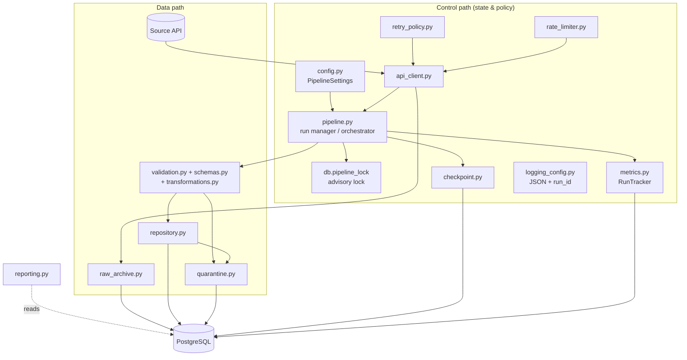
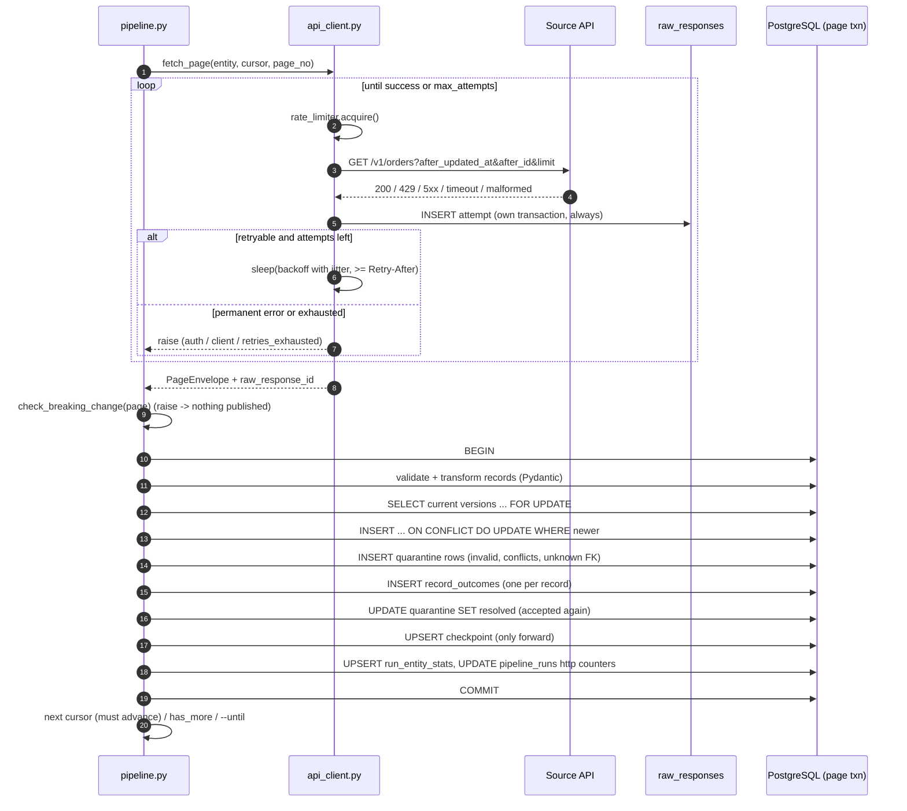

# Architecture

This is a small **modular monolith**: one Python package, one process per run,
one PostgreSQL database. Each module has a single responsibility and the
pieces talk through plain function calls and the database.

## 1. Components



### Module responsibilities

| Module | Responsibility | Talks to |
|---|---|---|
| `config.py` | Typed settings from env/.env; secrets as `SecretStr` | everything |
| `logging_config.py` | JSON/text log formatter, `run_id`/`entity` context vars, secret redaction | everything |
| `models.py` | SQLAlchemy Core table definitions + constraints | repository, reporting, migrations |
| `db.py` | Engine factory (UTC sessions), Alembic runner, advisory lock | pipeline, CLI, tests |
| `errors.py` | Exception hierarchy with `category` and `retryable` | client, pipeline |
| `schemas.py` | Pydantic models: page envelope, `OrderRecord`, `OrderEventRecord` | client, validation |
| `transformations.py` | Pure normalisers (amount, timestamp, enum, currency, id), record hash | schemas |
| `validation.py` | Validate one record → `ValidationResult`; breaking-change detection | pipeline |
| `rate_limiter.py` | Minimum interval between requests (client-side throttle) | api_client |
| `retry_policy.py` | Backoff with full jitter, `Retry-After` handling, attempt bound | api_client |
| `api_client.py` | HTTP calls, auth header, error classification, retries, hands every attempt to the archive | pipeline |
| `raw_archive.py` | Insert each attempt into `raw_responses` in its own transaction | api_client (callback) |
| `repository.py` | Classify valid records (inserted/updated/duplicate/stale/conflict), idempotent upserts | pipeline |
| `quarantine.py` | Quarantine rows, outcome ledger, quarantine resolution | pipeline |
| `checkpoint.py` | Load/advance (monotonic)/reset checkpoints; compute the scan start | pipeline, CLI |
| `metrics.py` | Run row lifecycle, per-entity counters, abandoned-run detection | pipeline |
| `pipeline.py` | Orchestrates entities and pages; owns transaction boundaries | CLI, tests |
| `reporting.py` | Run summaries, reconciliation checks, oracle comparison, Markdown report | CLI, benchmark |
| `datagen.py` | Deterministic feed + oracle generator | CLI, mock API, tests |
| `mock_api/` | FastAPI source simulator + fault rules | CLI, tests |
| `benchmark.py` | Repeatable throughput benchmark harness | CLI |
| `cli.py` | `ingest` command | user |

## 2. Source API contract

```
GET /v1/{orders|order_events}?limit=N
      [&after_updated_at=TS&after_id=ID]   exclusive keyset cursor (continue after this row)
      [&updated_since=TS]                  inclusive start (incremental lookback / backfill)
Authorization: Bearer <token>

200 {"data": [ ...records... ], "has_more": bool,
     "next_cursor": {"after_updated_at": TS, "after_id": ID} | null}
401 bad/missing token    429 + Retry-After    5xx transient    400 bad parameters
```

Rows are ordered by `(source_updated_at, source_record_id)`. `source_record_id`
is unique per row of the source change feed, so the pair is a **total order**:
two rows with the same timestamp are still strictly ordered and a cursor
pointing between them is unambiguous.

The pipeline relies only on this documented contract: ordering,
`has_more`, `next_cursor`, status codes. It does **not** rely on mock-only
behaviour (release phases and fault rules exist only to create test scenarios).

## 3. Data flow (one page)



## 4. Control flow (one run)

```mermaid
flowchart TD
    S([ingest run]) --> L{advisory lock<br/>acquired?}
    L -- no --> X1([ConcurrentRunError, exit 1])
    L -- yes --> AB[mark stale 'running' runs as 'abandoned']
    AB --> RS[insert pipeline_runs status=running<br/>checkpoint_before]
    RS --> E1[entity = orders]
    E1 --> ST{start position}
    ST -- --since --> BF[updated_since = since<br/>advance checkpoint only if contiguous]
    ST -- checkpoint + lookback --> LB[updated_since = checkpoint - lookback]
    ST -- no checkpoint --> BEG[from the beginning]
    BF --> PG
    LB --> PG
    BEG --> PG[page loop]
    PG -->|has_more = false| E2[entity = order_events]
    E2 --> PG2[page loop] --> FIN
    PG -->|PipelineError| FAIL[status=failed, failure_category]
    FIN[status=succeeded<br/>checkpoint_after, duration, http counters] --> U([unlock])
    FAIL --> U
```

Orders are ingested before events in every run because events reference
orders (`order_events.order_id → orders.order_id`).

## 5. Transaction boundaries

| Transaction | Contains | Why separate |
|---|---|---|
| Run start | `pipeline_runs` insert | The run must be visible even if it later crashes |
| **Raw archive** (per HTTP attempt) | one `raw_responses` row | Evidence must survive even when processing fails or rolls back |
| **Page** (per page) | target upserts, quarantine, ledger, quarantine resolution, checkpoint, entity counters, HTTP counters | **Atomic unit of progress**: either all of a page's effects exist or none do |
| Run finish | status, duration, `checkpoint_after`, failure info | Written last; absent if the process dies (→ later marked `abandoned`) |

Because the checkpoint lives in the *same* database and the *same*
transaction as the target rows, the classic "crash after writing data but
before saving the checkpoint" window **does not exist** here. The remaining
window is "crash after the API returned data but before COMMIT". There, the
page is simply fetched again next time, and idempotent upserts make the
replay harmless.

## 6. Where state lives

| State | Location | Why there |
|---|---|---|
| Configuration | env vars / `.env` | 12-factor; secrets never in code or git |
| Checkpoints | `checkpoints` table | Must commit atomically with target data |
| Run metadata + counters | `pipeline_runs`, `run_entity_stats` | Durable and queryable, survive the process |
| Raw responses | `raw_responses` (JSONB) | Replay/debug source; one authoritative copy (no file archive to reconcile) |
| Per-record history | `record_outcomes` | Exact reconciliation and lineage |
| Rejected records | `quarantine` | Auditable, re-processable |
| Single-runner guarantee | PostgreSQL advisory lock | Released automatically if the process dies |
| Retry/throttle timing | in memory | Per-process by nature; nothing to persist |

## 7. How failures propagate

| Failure | Raised by | Retried? | Effect on run |
|---|---|---|---|
| 429 | `api_client` → `RateLimitedError` | yes, wait ≥ `Retry-After` (≤ cap) | continues; counted in `http_rate_limited` |
| 500/502/503/504 | `TransientServerError` | yes, backoff + jitter | continues; counted in `http_server_errors` |
| timeout / connection error | `RequestTimeoutError` / `TransportError` | yes | continues; counted |
| malformed body / envelope | `MalformedResponseError` | yes (configurable) | continues or fails `retries_exhausted` |
| attempts exhausted | `RetriesExhaustedError` | no | **failed**, checkpoint stays at last committed page |
| 401/403 | `AuthenticationError` | **no** | **failed** immediately (1 attempt) |
| other 4xx | `ClientRequestError` | no | **failed** |
| required field missing from a whole page | `BreakingSchemaChangeError` | no | **failed** before publishing that page |
| cursor not advancing | `NonAdvancingCursorError` | no | **failed** (prevents infinite loop) |
| invalid record | (not an exception) | n/a | record quarantined, run continues |
| database error | SQLAlchemy `DBAPIError` | no | page rolled back, run `failed` (`database_error`), exception re-raised |
| process killed | n/a | n/a | page rolled back by Postgres; run left `running` → `abandoned` by next run |

`PipelineError` subclasses are expected operational failures: they are
recorded and the CLI exits with code 1. Unexpected exceptions are recorded as
`unexpected_error` and **re-raised** so the stack trace is not hidden.

## 8. Tracing a record end to end

Example from the demo dataset: source row `ORDV-000000001`.

```sql
-- 1. Which HTTP responses carried it, and what happened each time?
SELECT o.run_id, o.outcome, r.raw_response_id, r.page_number, r.attempt, r.request_id
FROM record_outcomes o JOIN raw_responses r USING (raw_response_id)
WHERE o.source_record_id = 'ORDV-000000001' ORDER BY o.outcome_id;

-- 2. The exact JSON the API returned for it
SELECT r.body -> 'data' -> o.record_position
FROM record_outcomes o JOIN raw_responses r USING (raw_response_id)
WHERE o.source_record_id = 'ORDV-000000001' LIMIT 1;

-- 3. Its effect on the target (if it is the current version)
SELECT * FROM orders WHERE source_record_id = 'ORDV-000000001';

-- 4. Or why it was rejected
SELECT error_codes, errors, payload FROM quarantine WHERE source_record_id = 'ORDV-000000001';
```

## 9. Design review of major components

### 9.1 Keyset pagination + composite cursor
1. **Problem:** read a changing, ordered feed page by page without skipping or repeating rows.
2. **Why needed:** offset pagination shifts when rows are added; timestamp-only cursors lose rows that share a timestamp.
3. **Alternatives:** offset/limit; opaque server page tokens; timestamp-only watermark with `>=` and dedupe.
4. **Chosen because:** `(timestamp, unique id)` is a total order, cheap for the server (index range scan) and doubles as the checkpoint.
5. **Limitations:** requires the source to sort by and filter on that pair; rows that appear later with an *older* timestamp are behind the cursor (handled by lookback/backfill).

### 9.2 Page transaction (data + checkpoint together)
1. **Problem:** progress must never get ahead of persisted data.
2. **Why needed:** a checkpoint saved before the data is lost on a crash would skip records for ever.
3. **Alternatives:** checkpoint in a file; checkpoint after the whole run; two-phase commit with an external store.
4. **Chosen because:** same database means one ACID transaction, the simplest correct option.
5. **Limitations:** ties the checkpoint store to the target database; long pages mean longer transactions.

### 9.3 Raw archive in JSONB
1. **Problem:** debugging, auditing and replay need the original response.
2. **Why needed:** after a transformation bug or schema change you must be able to see exactly what was received.
3. **Alternatives:** local files; object storage; storing only hashes.
4. **Chosen because:** zero extra infrastructure, queryable with SQL, joinable to quarantine and the ledger.
5. **Limitations:** database growth; no lifecycle policy yet; object storage is better at scale (see ADR-7).

### 9.4 Validation + quarantine
1. **Problem:** bad records must not reach the target, but must not vanish either.
2. **Why needed:** silently dropping data hides source problems; failing the whole run on one bad row blocks everything.
3. **Alternatives:** fail-fast per batch; drop-and-log; dead-letter files.
4. **Chosen because:** record-level isolation with full traceability; whole-page structural problems still fail fast.
5. **Limitations:** quarantined data needs a human (or a backfill) to be fixed; thresholds are heuristics.

### 9.5 Idempotent repository
1. **Problem:** the same record can arrive many times and in any order.
2. **Why needed:** at-least-once extraction is the realistic guarantee.
3. **Alternatives:** dedupe tables; delete-and-reload; append-only with views.
4. **Chosen because:** business-key upserts with a version guard make replays harmless and keep the target small.
5. **Limitations:** orders keep only the latest state (history is in raw/ledger).

### 9.6 Run tracking + ledger
1. **Problem:** prove the numbers add up and explain any difference.
2. **Why needed:** "the job succeeded" says nothing about data completeness.
3. **Alternatives:** logs only; counters only.
4. **Chosen because:** counters written in the page transaction plus a per-record ledger give exact, cross-checkable reconciliation.
5. **Limitations:** the ledger grows by one row per delivered record (needs retention at scale).

### 9.7 Mock API
1. **Problem:** evaluate the pipeline offline, deterministically, including failures.
2. **Why needed:** real APIs can't be made to fail on demand.
3. **Alternatives:** recorded HTTP cassettes; WireMock; `respx` stubs only.
4. **Chosen because:** a real server (FastAPI) exercises the true HTTP path; fault rules make every scenario reproducible.
5. **Limitations:** it only simulates failure modes we thought of.

## 10. Why this architecture fits the assessment

* Every requirement is implemented in a few hundred lines a junior engineer can read end to end.
* Correctness comes from database guarantees (transactions, constraints, unique keys), not from infrastructure.
* It runs on a laptop in seconds, and the tests use a real PostgreSQL.
* The extension points are clear: raw archive → object storage, entity loop → parallel workers, CLI → scheduler (cron/Airflow) without changing the core.
