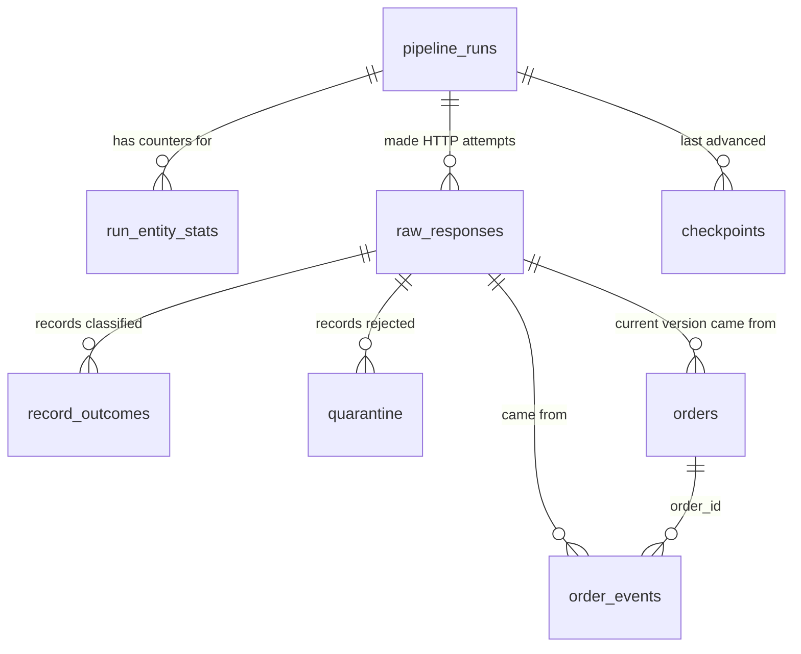

# Data Dictionary

All timestamps are `timestamptz` and stored/returned in **UTC** (sessions set
`timezone=UTC`). Money is `NUMERIC(12,2)` and handled as Python `Decimal`,
never `float`. Naming is `snake_case`.

## Entity relationship



## Key concepts

| Concept | In this project |
|---|---|
| **Business key** | Identifier meaningful to the business: `order_id`, `event_id`. Used for upserts and uniqueness. |
| **Source row id** | `source_record_id`: unique id of one row of the source change feed (`ORDV-…`, `EVTV-…`). One order can have many (one per version or re-delivery). |
| **Surrogate key** | System-generated id with no business meaning: `raw_response_id`, `quarantine_id`, `outcome_id` (bigserial), `run_id` (UUID). |
| **Source timestamp** | `source_updated_at`: when the *source* changed the row. Drives extraction order and version comparison. |
| **Business timestamps** | `created_at`, `updated_at` (orders), `event_timestamp` (events): when things happened in the business. |
| **Ingestion timestamps** | `first_ingested_at`, `last_ingested_at`, `ingested_at`, `retrieved_at`, `rejected_at`: when *this pipeline* processed the data (processing time). |
| **Event time vs processing time** | `event_timestamp` = event time; `ingested_at` = processing time. An event can be ingested days after it happened. |
| **Record creation vs update** | `created_at` never changes for an order; `updated_at` / `source_updated_at` move forward with each new version. |
| **Duplicate business record vs repeated delivery** | Two *different* events always have different `event_id`s. The same `event_id` delivered twice (two `source_record_id`s) is a *repeated delivery*: identical content → `duplicate`, different content → `CONFLICTING_DUPLICATE` (quarantined). |
| **Invalid vs late** | *Invalid* = breaks a rule (quarantined). *Late* = valid but arrives after rows with later timestamps (accepted, recovered by lookback/backfill). |

---

## Target tables

### `orders`: latest state per order

**Grain:** one row per `order_id` (the latest valid version seen).
**History:** not kept in this table. Every version is retained in
`raw_responses`, and its outcome is in `record_outcomes`.

| Column | Type | Null | Key / constraint | Meaning | Example | Validation / transformation |
|---|---|---|---|---|---|---|
| `order_id` | varchar(32) | no | **PK** (business key) | Order identifier | `ORD-00000042` | trimmed; must match `ORD-[0-9]{6,12}` |
| `customer_id` | varchar(32) | no | indexed | Customer reference (no customer table in scope) | `CUST-000017` | trimmed; `CUST-[0-9]{4,12}` |
| `order_status` | varchar(20) | no | CHECK in (`pending`,`paid`,`shipped`,`delivered`,`cancelled`,`refunded`) | Current status | `shipped` | lower-cased, trimmed, spaces/hyphens → `_` (`"  SHIPPED "` → `shipped`) |
| `order_amount` | numeric(12,2) | no | CHECK ≥ 0 | Order total | `149.50` | Decimal; ≥ 0; ≤ 2 decimals (never rounded); ≤ 9,999,999,999.99; bool rejected |
| `currency` | varchar(3) | no | CHECK in (`USD`,`EUR`,`GBP`,`INR`) | ISO-4217 code | `EUR` | upper-cased, trimmed |
| `created_at` | timestamptz | no | CHECK `updated_at >= created_at` | When the order was created | `2026-01-01T00:00:20Z` | ISO-8601 with offset required; converted to UTC |
| `updated_at` | timestamptz | no | | Business last-update time of this version | `2026-01-01T02:15:20Z` | as above; must be ≥ `created_at` (`TIMESTAMP_ORDER`) |
| `source_updated_at` | timestamptz | no | indexed | Source modification time of this version; **version ordering key** | `2026-01-01T02:15:22Z` | as above |
| `source_record_id` | varchar(64) | no | | Feed row that produced the current state | `ORDV-000000123` | `[A-Za-z0-9_-]{1,64}` |
| `record_hash` | char(64) | no | | SHA-256 of normalised business fields (excludes version metadata and unknown fields) | `9f2c…` | derived |
| `first_ingested_at` | timestamptz | no | | When this order first entered the table | | derived, never updated |
| `last_ingested_at` | timestamptz | no | | When the current version was written | | derived |
| `first_run_id` / `last_run_id` | uuid | no | FK → `pipeline_runs` | Runs that inserted / last updated it | | derived |
| `raw_response_id` | bigint | no | FK → `raw_responses` | HTTP response the current version came from | | derived |

**Conflict rule:** an incoming version replaces the row only if its
`source_updated_at` is **strictly greater**. Equal timestamp + equal hash →
`duplicate`. Equal timestamp + different hash → quarantined
`CONFLICTING_DUPLICATE`. Older → `stale` (ignored). The rule is checked in
Python *and* repeated in the upsert's `WHERE orders.source_updated_at < excluded.source_updated_at`.

### `order_events`: append-only facts

**Grain:** one row per distinct `event_id`. Events are immutable, so they are never updated.

| Column | Type | Null | Key / constraint | Meaning | Example | Validation |
|---|---|---|---|---|---|---|
| `event_id` | varchar(40) | no | **PK** | Event identifier | `EVT-0000000007` | `EVT-[0-9]{6,14}` |
| `order_id` | varchar(32) | no | **FK → orders.order_id**, indexed with `event_timestamp` | Order the event belongs to | `ORD-00000003` | must exist in `orders` at publish time, else `UNKNOWN_ORDER_ID` |
| `event_type` | varchar(30) | no | CHECK in (`order_created`,`payment_authorized`,`order_shipped`,`order_delivered`,`order_cancelled`,`order_refunded`) | Classification | `order_shipped` | normalised like status |
| `event_timestamp` | timestamptz | no | | **Event time**: when it happened | `2026-01-01T03:00:00Z` | ISO-8601 with offset → UTC |
| `source_updated_at` | timestamptz | no | | When the source published it | | |
| `source_record_id` | varchar(64) | no | | Feed row it came from (first delivery) | `EVTV-000000010` | |
| `record_hash` | char(64) | no | | SHA-256 of `event_id, order_id, event_type, event_timestamp` | | derived |
| `ingested_at` | timestamptz | no | | **Processing time** | | derived |
| `run_id` | uuid | no | FK | Run that inserted it | | |
| `raw_response_id` | bigint | no | FK | Response it came from | | |

Out-of-order events (older `event_timestamp` arriving later) are inserted
normally; ordering by event time is a query concern (`ORDER BY event_timestamp`).

---

## Control and audit tables

### `pipeline_runs`: one row per run
| Column | Type | Null | Meaning |
|---|---|---|---|
| `run_id` | uuid | no (PK) | Run identifier (also on every log line) |
| `pipeline_name`, `pipeline_version` | varchar | no | `orders_api_ingestion`, `1.0.0` |
| `status` | varchar | no | CHECK: `running`, `succeeded`, `failed`, `abandoned` |
| `mode` | varchar | no | CHECK: `incremental`, `backfill` (`--since` given) |
| `source` / `target` | text | no | Sanitised API base URL / DB URL with password hidden |
| `params` | jsonb | no | entities, since/until, page size, lookback, write mode, page budget |
| `started_at`, `finished_at` | timestamptz | start no / finish yes | wall-clock times |
| `duration_seconds` | numeric(12,3) | yes | measured with a monotonic clock |
| `checkpoint_before`, `checkpoint_after` | jsonb | yes | `{entity: {source_updated_at, source_record_id}}` |
| `http_attempts`, `http_retries`, `http_rate_limited`, `http_server_errors`, `http_timeouts` | int | no | HTTP counters |
| `failure_category` | varchar | yes | e.g. `authentication`, `retries_exhausted`, `breaking_schema_change`, `database_error`, `process_died` |
| `error_message` | text | yes | Redacted, truncated to 2,000 chars |

### `run_entity_stats`: counters per run and entity (PK `run_id, entity`)
`pages_requested`, `pages_processed`, `records_fetched`, `records_valid`,
`records_inserted`, `records_updated`, `records_duplicate`, `records_stale`,
`records_quarantined`, `unknown_fields` (jsonb `{field: count}`),
`start_cursor`, `end_cursor`. Written **inside each page transaction**.

### `checkpoints`: PK (`pipeline_name`, `entity`)
| Column | Meaning |
|---|---|
| `cursor_updated_at`, `cursor_record_id` | Keyset position of the last row of the last **committed** page. `cursor_record_id` uses `COLLATE "C"` so the database compares ids byte-wise, the same order the source uses. |
| `last_run_id` | Run that last advanced it |
| `updated_at` | When it moved |

Advances are monotonic: `ON CONFLICT … WHERE (old_ts, old_id) < (new_ts, new_id)`.

### `raw_responses`: one row per HTTP attempt
| Column | Meaning |
|---|---|
| `raw_response_id` | bigserial PK (surrogate) |
| `run_id`, `entity`, `page_number`, `attempt` | Where in the run this attempt happened |
| `endpoint`, `request_params` | Sanitised URL and query parameters (cursor/limit). **No headers, no token.** |
| `outcome` | CHECK: `ok`, `http_error`, `malformed`, `timeout`, `transport_error` |
| `status_code`, `request_id` (`X-Request-ID`), `elapsed_ms`, `retrieved_at` | Response metadata |
| `body_sha256` | SHA-256 of the exact response bytes |
| `body` | Parsed JSON (JSONB) when the body was valid JSON |
| `body_text` | Raw text (≤ 64 KB) for error and malformed responses |
| `record_count` | Records in `data` for `ok` responses |
| `error` | Short description for non-ok outcomes |

### `record_outcomes`: lineage ledger (one row per record per delivery)
`outcome_id`, `run_id`, `entity`, `raw_response_id`, `record_position` (index
in `data`), `source_record_id`, `business_key`, `outcome` (CHECK `inserted`,
`updated`, `duplicate`, `stale`, `quarantined`). Unique on
(`raw_response_id`, `record_position`).

### `quarantine`
| Column | Meaning |
|---|---|
| `quarantine_id` | bigserial PK |
| `run_id`, `entity` | Where it was rejected |
| `raw_response_id`, `record_position` | **Exact location in the raw response**: `raw_responses.body->'data'->record_position` equals `payload` |
| `source_record_id`, `business_key` | Best-effort identifiers (null if missing/unusable) |
| `payload` | Original record exactly as received (jsonb) |
| `error_codes` | text[] of stable codes (below) |
| `errors` | jsonb list of `{code, field, message}` |
| `rejected_at` | timestamp |
| `resolved_at`, `resolved_by_run_id` | Set when the same source row is later accepted (e.g. an event whose order arrived afterwards) |

#### Error codes
| Code | Meaning |
|---|---|
| `MISSING_REQUIRED_FIELD` | Field absent (including a missing primary key) |
| `NULL_NOT_ALLOWED` | Field present but `null` |
| `INVALID_TYPE` | Wrong JSON type (e.g. object instead of amount, bool amount) |
| `INVALID_IDENTIFIER` | Id does not match its format |
| `INVALID_ENUM` | Status / event type not allowed |
| `INVALID_CURRENCY` | Not a supported ISO-4217 code |
| `INVALID_AMOUNT` | Not a finite decimal number |
| `NEGATIVE_AMOUNT` | Amount < 0 |
| `INVALID_AMOUNT_PRECISION` | More than 2 decimals (not rounded) |
| `AMOUNT_OUT_OF_RANGE` | > 9,999,999,999.99 |
| `INVALID_TIMESTAMP` | Not ISO-8601 or no time-zone offset |
| `TIMESTAMP_ORDER` | `updated_at` earlier than `created_at` |
| `NOT_AN_OBJECT` | Array element is not a JSON object |
| `CONFLICTING_DUPLICATE` | Same key and version (orders) or same `event_id` (events) with different content |
| `UNKNOWN_ORDER_ID` | Event references an order not in `orders` |

---

## Count semantics

These words mean different things and are never used interchangeably:

| Term | Definition |
|---|---|
| **fetched** | Records in `data` of committed pages, counted **per delivery** (a record re-read by a lookback is fetched again) |
| **valid** | Passed schema validation |
| **inserted** | Created a new target row (new business key) |
| **updated** | Replaced a target row with a newer version |
| **duplicate** | Same version and content as the target already has (re-delivery/replay); no write |
| **stale** | Older than the target version; ignored by policy (the "skipped" count) |
| **quarantined** | Written to `quarantine` (invalid, conflicting, unknown FK) |

Identity enforced for every run and entity:

```
records_fetched = inserted + updated + duplicate + stale + quarantined = rows in record_outcomes
```

### Why raw counts differ from target counts (demo numbers)

From [reports/demo/06_reconciliation.md](../reports/demo/06_reconciliation.md):
637 distinct order source rows were delivered **1,315** times across four
runs, yet `orders` has **214** rows. The difference is fully explained:

| Reason | Effect |
|---|---|
| Each order has several versions (`pending → paid → shipped …`) | 385 `updated` outcomes collapse into existing rows |
| Lookback windows and the backfill re-read rows | 252 `duplicate` + 395 `stale` outcomes |
| Invalid and conflicting rows | 69 `quarantined` deliveries of 34 distinct rows |
| Retries | separate `raw_responses` rows with `outcome='http_error'`, carrying no records |

214 + 385 + 252 + 395 + 69 = 1,315, with no unexplained difference.

## Tracing quarantined records to raw data

```sql
SELECT q.quarantine_id, q.error_codes, q.errors,
       r.run_id, r.page_number, r.attempt, r.request_id, r.request_params,
       r.body -> 'data' -> q.record_position = q.payload AS matches_raw
FROM quarantine q JOIN raw_responses r USING (raw_response_id)
WHERE q.source_record_id = 'ORDV-000000589';   -- INVALID_ENUM in the demo dataset
```
